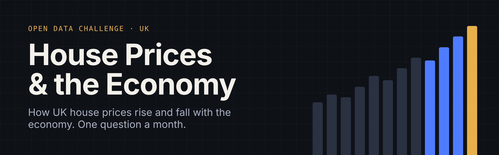
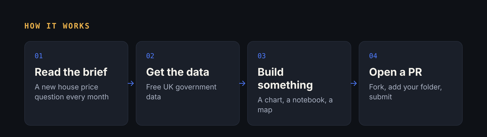

# House Prices & the Economy

**A free, friendly UK data challenge. One question a month about how house prices rise and fall with the economy.**

House prices are not just about houses. They go up and down with jobs, pay, interest rates and the cost of living. When the economy struggles, prices usually feel it. When borrowing is cheap, they tend to climb.

This project uses free UK government data to explore those links. Each month there is a new question. You dig into the data, make something (a chart, a short notebook, a map) and share it. No sign-up and no gatekeeping. Beginners are very welcome.

---

## This month

### November 2026: Booms and busts

**The question:** How do house prices react when the economy changes?

The average UK home cost **£51,067 in January 1995**. By **August 2026 it was £273,037**, more than five times as much. But the climb has not been smooth. Prices fell 19% after the 2008 financial crisis, jumped during the stamp duty holiday, then dipped again when interest rates went up.

**Runs:** 1 to 30 November 2026
**Full brief:** [challenges/2026-11-booms-and-busts](challenges/2026-11-booms-and-busts/README.md)

| Level | What you'll do |
|---|---|
| 🟢 Beginner | Chart prices in one place over time and spot the ups and downs |
| 🟡 Intermediate | Compare places or types of home. Who was hit hardest, and who bounced back? |
| 🔴 Expert | Link prices to the wider economy and tell the story |

---

## How it works

1. **Read the brief** for this month in the [`challenges`](challenges/) folder.
2. **Download the data.** It's free from GOV.UK, and the brief links to it.
3. **Make something.** Python, R, Excel, Tableau, pen and paper scanned in: anything goes.
4. **Share it.** Fork this repo, add a folder at `submissions/2026-11/your-github-username/` with a short `README.md` (use the [template](SUBMISSION_TEMPLATE.md)), then open a pull request.

New to GitHub? [CONTRIBUTING.md](CONTRIBUTING.md) walks you through it step by step.

---

## What's coming up

Each month adds one piece of the economy and puts it next to house prices.

| Month | Question | Extra data |
|---|---|---|
| **Nov 2026** | **Booms and busts:** how do prices react when the economy changes? | UK House Price Index |
| Dec 2026 | **Can people afford a home?** Prices compared with pay | ONS housing affordability |
| Jan 2027 | **Interest rates:** what happens when borrowing gets more expensive? | Bank of England Bank Rate |
| Feb 2027 | **Are homes really dearer?** Prices after taking inflation into account | ONS Consumer Prices Index |

The order may change. Vote in [Discussions](https://github.com/ShazMoghaddam/uk-house-prices-economy/discussions) or [suggest an idea](https://github.com/ShazMoghaddam/uk-house-prices-economy/issues/new?template=idea-suggestion.yml).

---

## Key ideas in plain English

| Word | What it means |
|---|---|
| **Average price** | The typical price paid for a home in a place, in pounds |
| **Annual change** | How much prices went up or down compared with the same month a year before |
| **The economy** | Everything to do with money in the country: jobs, wages, businesses, spending and borrowing |
| **Recession** | When the economy shrinks for a while. Businesses earn less and some people lose jobs |
| **Interest rate** | The cost of borrowing money. The Bank of England sets the main one, called **Bank Rate** |
| **Mortgage** | A loan to buy a home. Higher interest rates mean bigger monthly payments |
| **Inflation** | When everyday prices go up over time, so each pound buys a bit less |
| **Affordability** | How many years of a typical salary it takes to pay for a typical home |
| **Stamp duty** | A tax you pay when you buy a home |
| **"2016 = 100"** | A way to compare growth. Every line starts at 100, so 145 means 45% higher than in 2016 |

---

## Gallery

The best entries each month are featured here.

### November 2026
*Be the first. Submissions open 1 November.*

---

## Join the conversation

Head to [Discussions](https://github.com/ShazMoghaddam/uk-house-prices-economy/discussions) to share early findings, ask questions, give feedback on other people's work and vote on what comes next.

---

## Data and licences

All data comes from UK public bodies under the [Open Government Licence v3.0](https://www.nationalarchives.gov.uk/doc/open-government-licence/version/3/). Each brief says where the data comes from and how to credit it.

Code and content in this repo are [MIT licensed](LICENSE). By submitting a pull request you agree to share your entry under the same licence.

---

Created by **Shaz Moghaddam** · London
[Website](https://shazmoghaddam.github.io) · [LinkedIn](https://www.linkedin.com/in/shazmoghaddam)
