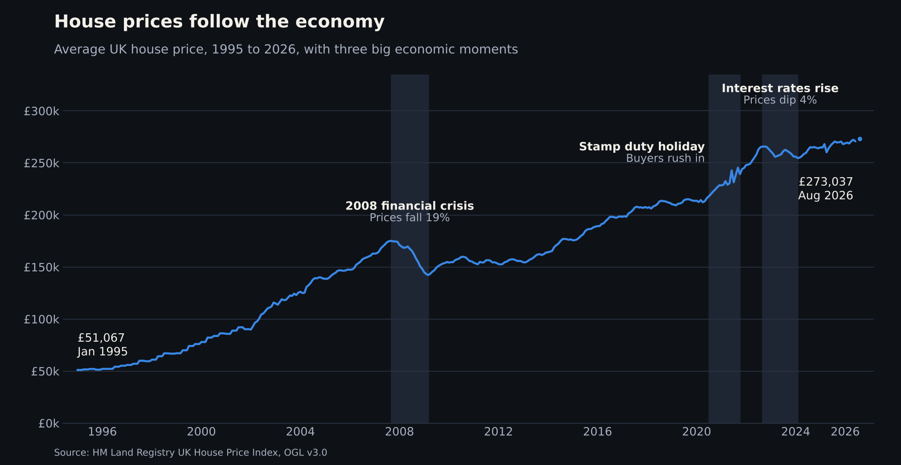
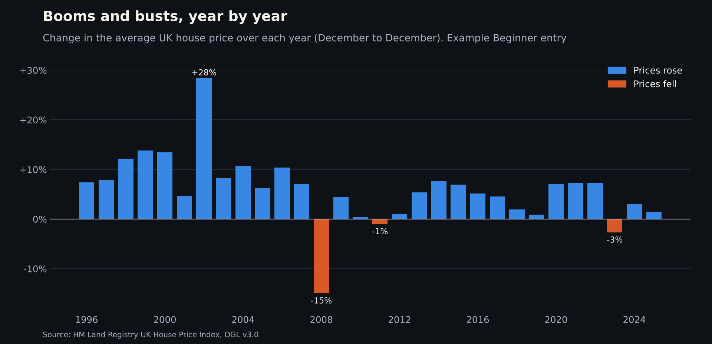
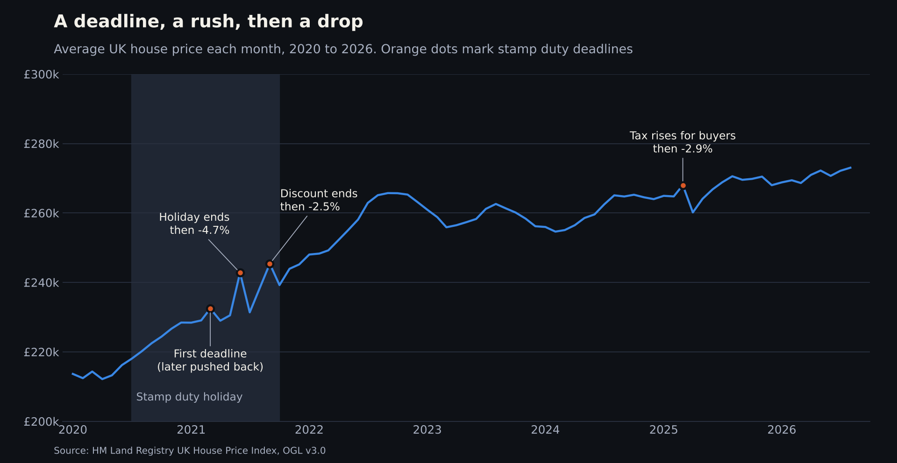
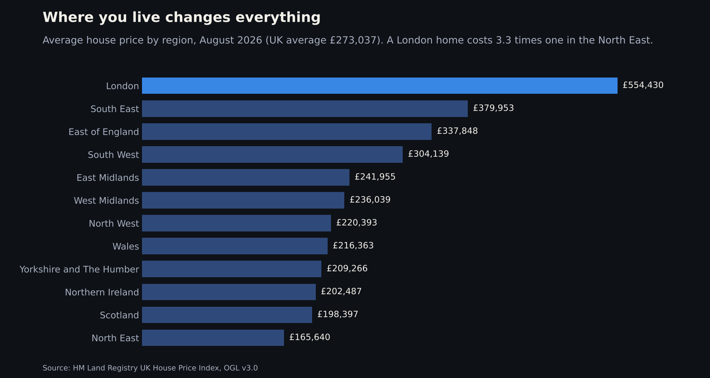
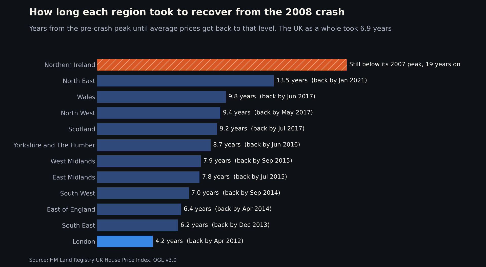
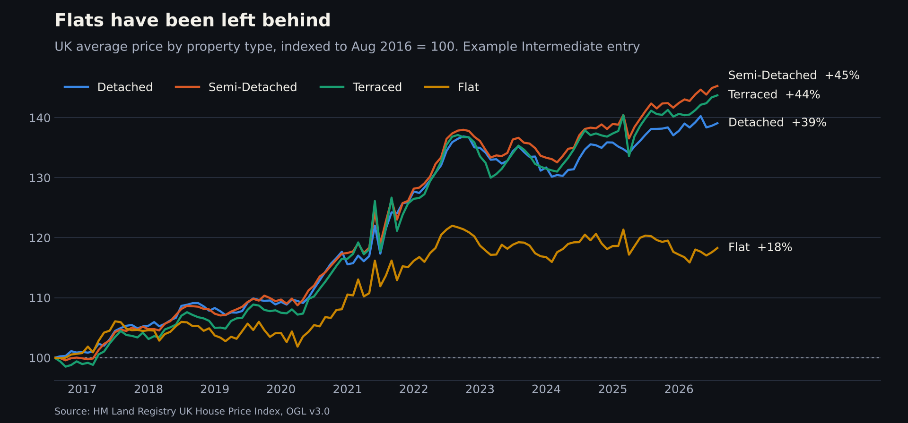

# November 2026: Booms and busts

**The question:** How do house prices react when the economy changes?

**Runs:** 1 to 30 November 2026
**Data:** UK House Price Index, August 2026 release (free from GOV.UK)

---

## The story so far

The average UK home cost **£51,067 in January 1995**. By **August 2026 it was £273,037**.

That sounds like a smooth climb, but it wasn't. House prices react to what's happening in the wider economy. Three moments stand out:



**1. The 2008 financial crisis**
Banks got into trouble and stopped lending as freely, and the UK went into recession. Fewer people could get a mortgage, so fewer people could buy. Prices fell **19%** between September 2007 and March 2009. They didn't get back to their old peak until **August 2014**, almost seven years later.

**2. The stamp duty holiday (2020 to 2021)**
During the pandemic, the government cut stamp duty, the tax you pay when you buy a home. Buyers rushed to move before the deadline, and prices shot up. Look for the spike and sudden drop in mid-2021 when the holiday ended.

**3. Interest rates go up (2022 to 2024)**
To bring rising prices under control, the Bank of England raised interest rates many times, from 0.1% in late 2021 to 5.25% by August 2023. Mortgages got much more expensive. UK house prices dipped **4%** between September 2022 and February 2024.

Your job is to dig into these moments, or find new ones.

---

## Year by year

Here is the same story as a simple bar for each year. Blue bars are years when prices rose, orange bars are years when they fell.



Only three years since 1996 saw prices fall: 2008 (down 15%), 2011 (down 1%) and 2023 (down 3%). Each one lines up with tough times in the economy.

---

## Close-up: a deadline, a rush, then a drop

Tax changes leave their own mark. Every time a stamp duty deadline arrived, buyers rushed to beat it, prices jumped, then fell back the month after.



When the full holiday ended in June 2021, prices jumped 5.3%, then fell 4.7% in July. When stamp duty went up for many buyers in April 2025, prices fell 2.9% in a single month. Within a few months, the market was back on its usual path.

---

## It depends where you live

The economy isn't the same everywhere, and neither are house prices.



A London home costs about **3.3 times** one in the North East. And when the 2008 crash hit, the regions didn't recover at the same speed either.



London got back to its pre-crash price in about 4 years. The North East took 13.5 years. Northern Ireland fell 57%, and 19 years later it's still below its 2007 peak.

And it depends what kind of home you buy. Since 2016, houses have risen around 40%, but flats only 18%. Over the last year flats actually fell.



*All six charts are made from the files below, so you can recreate them.*

---

## Get the data

It's free from HM Land Registry on GOV.UK:

**[UK House Price Index: data downloads August 2026](https://www.gov.uk/government/statistical-data-sets/uk-house-price-index-data-downloads-august-2026)**

You only need two of the smaller files:

| File | What's in it |
|---|---|
| `Average-prices-2026-08.csv` | The average price for every UK country, region and local area, month by month |
| `Average-prices-Property-Type-2026-08.csv` | The same, split into detached, semi-detached, terraced and flats |

**What the columns mean**

| Column | In plain English |
|---|---|
| `Date` | The month, e.g. `2026-08-01` means August 2026 |
| `Region_Name` | The place, e.g. `London`, `Manchester`, `Wales` |
| `Area_Code` | An official code for the place. Handy for making maps |
| `Average_Price` | The typical price of a home there, in pounds |
| `Monthly_Change` | How much prices changed since last month (%) |
| `Annual_Change` | How much prices changed since the same month last year (%) |

The property type file has the same idea for each type of home, for example `Flat_Average_Price` and `Flat_Annual_Change`.

---

## Pick your level


### 🟢 Beginner
Choose one place you care about: your town, your borough, where you grew up.
- Chart its average price over time
- Mark the 2008 crash and the 2020 to 2021 stamp duty holiday
- In one or two sentences: how did your place react?

### 🟡 Intermediate
Pick one question:
- Pick a local area. How long did it take to recover from 2008, compared with its region?
- Which local areas grew fastest in the stamp duty holiday?
- Is the flat slump happening everywhere, or mostly in London?
- Did the April 2025 stamp duty change hit cheaper areas or pricier ones harder?
- Why is Northern Ireland still below its 2007 peak? What does its price history look like?

### 🔴 Expert
Bring in one more piece of the economy and put it next to house prices. For example:
- [Bank of England Bank Rate](https://www.bankofengland.co.uk/boeapps/database/Bank-Rate): do prices slow down after rates rise? How long does it take?
- [ONS housing affordability](https://www.ons.gov.uk/peoplepopulationandcommunity/housing/bulletins/housingaffordabilityinenglandandwales/2025): where are homes furthest out of reach compared with pay?
- Your own idea. Unemployment, population or new homes being built all work.

Explain what you find in plain language. A clear finding beats a complicated model.

---

## Starter code

A small Python script, [`starter.py`](starter.py), gets you going. Save the CSV in this folder, then in Terminal on a Mac:

```bash
pip3 install pandas matplotlib
python3 starter.py Average-prices-2026-08.csv "London"
```

It prints a quick summary and saves a chart for the place you choose. If you spell a place wrong, it suggests real ones.

```
Region:        London
Rows:          701
Date range:    Apr 1968 to Aug 2026
Latest price:  £554,430 (Aug 2026)
Saved chart:   london-average-price.png
```

Please don't include the CSV files in your pull request. Just link to the source.

---

## Share your work

Put your work in `submissions/2026-11/your-github-username/` with a `README.md` based on the [submission template](../../SUBMISSION_TEMPLATE.md), then open a pull request. [CONTRIBUTING.md](../../CONTRIBUTING.md) has step-by-step help.

Credit the data like this:

> Contains HM Land Registry data © Crown copyright and database right 2026. This data is licensed under the Open Government Licence v3.0.

---

Created by **Shaz Moghaddam** · London
[Website](https://shazmoghaddam.github.io) · [LinkedIn](https://www.linkedin.com/in/shazmoghaddam)
